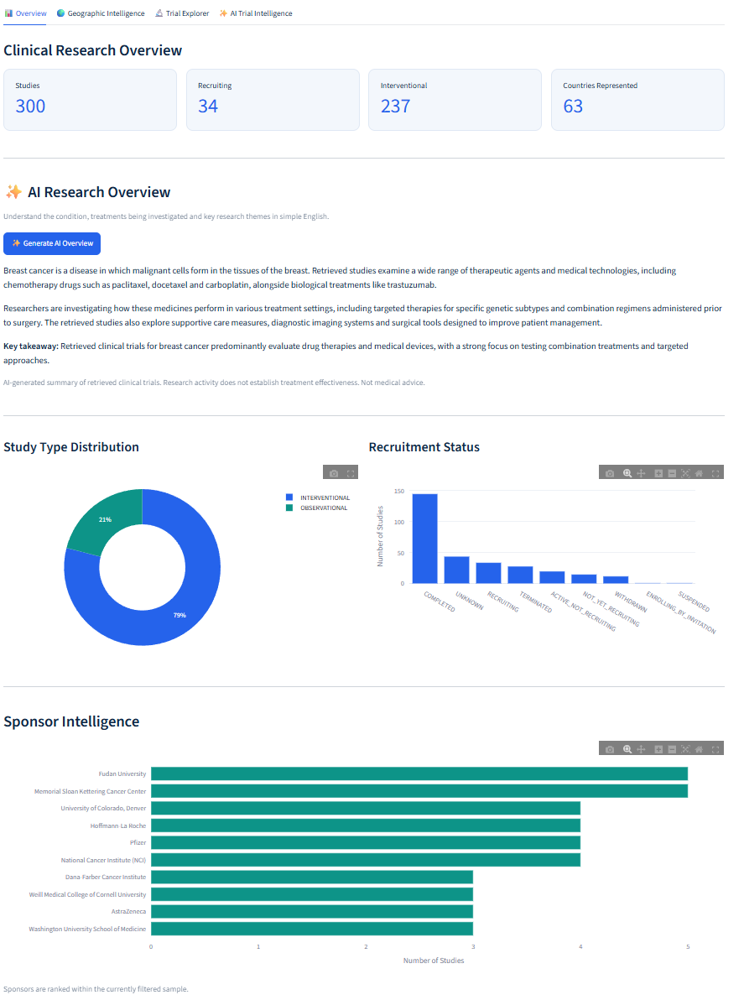
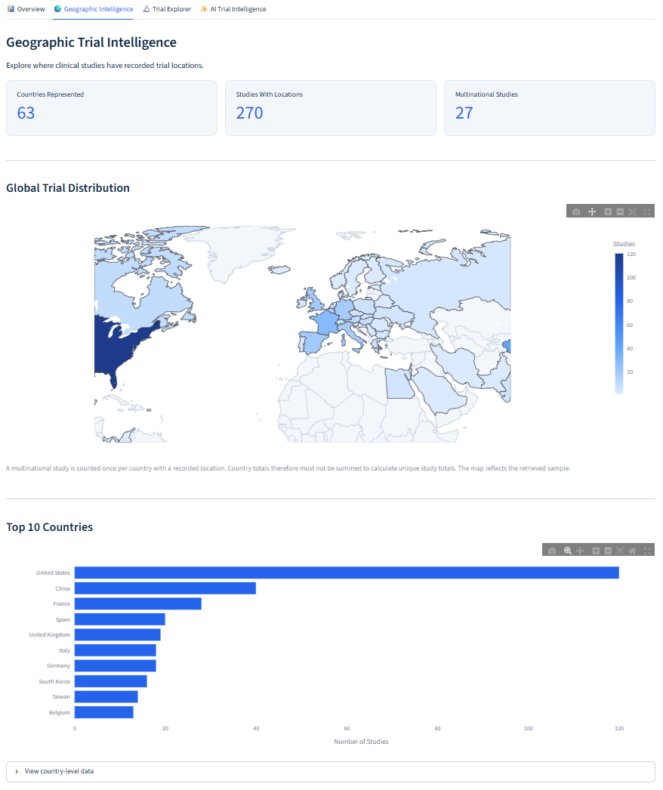
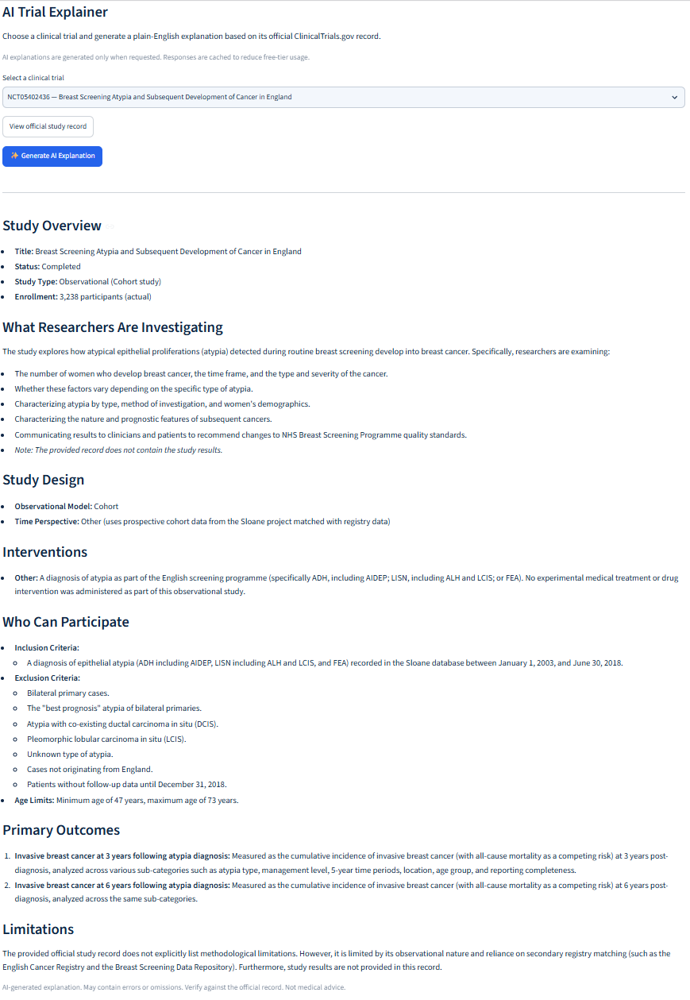

# 🧬 ClinicalUpDatabase

### Clinical Trial Intelligence | Data Analytics | Generative AI

**ClinicalUpDatabase** is an interactive clinical research intelligence platform built with Python, Streamlit and Google Gemini. It transforms publicly available clinical trial records into accessible visualisations, research insights and AI-generated explanations.

The project combines clinical development knowledge with data engineering, analytics and generative AI to make clinical trial information easier to explore and understand.

### 🚀 [Explore the Live Application](https://clinicalupdatabase.streamlit.app/)

---

## Application Preview

### Clinical Research Overview



### Geographic Intelligence



### AI Trial Intelligence



---

## Overview

ClinicalTrials.gov contains extensive information about registered clinical studies, but navigating individual records and identifying research patterns can be challenging.

ClinicalUpDatabase addresses this by retrieving structured study data through the ClinicalTrials.gov API and presenting it through an interactive dashboard.

Users can search medical conditions, explore study characteristics, investigate geographic research activity and generate plain-English explanations powered by Google Gemini.

**The objective:** Make clinical trial information more accessible while demonstrating the practical application of Python, data analytics and AI within clinical research.

---

## Key Features

### 📊 1. Clinical Research Overview

Explore the clinical trial landscape for a searched medical condition.

- Search ClinicalTrials.gov by medical condition
- Retrieve up to 1,000 registered studies
- View headline research metrics
- Explore recruitment status and trial phase distributions
- Identify frequently represented study sponsors
- Apply interactive filters to refine the dataset

### ✨ 2. AI Research Overview

Generate a concise, plain-English briefing about the searched condition and its associated clinical research.

Powered by **Google Gemini**, this feature:

- Explains the medical condition in accessible language
- Identifies medicines, therapies and technologies appearing in retrieved studies
- Highlights research themes supported by the available records
- Summarises key findings in approximately 100 words
- Distinguishes investigational activity from evidence of clinical effectiveness

Python processes study information before passing a compact research summary to Gemini, reducing unnecessary API usage.

### 🌍 3. Geographic Intelligence

Investigate the international distribution of registered clinical trials.

- Interactive geographic visualisation
- Country-level study counts
- Geographic research metrics
- Exploration of international study activity

Multinational studies can contribute to multiple country counts, so geographic totals should not be interpreted as mutually exclusive study counts.

### 🔬 4. Trial Explorer

Explore individual clinical trial records through an interactive, filterable dataset.

Available information includes:

- NCT identification numbers
- Study titles and sponsors
- Recruitment status
- Trial phases and study types
- Enrollment information
- Interventions and intervention types
- Countries of study activity
- Links to official ClinicalTrials.gov records

Users can also export selected data for further analysis.

### 🤖 5. AI Trial Intelligence

Select an individual clinical trial and generate a structured, plain-English explanation using Google Gemini.

Explanations cover:

- Study overview
- Research objectives
- Study design
- Investigational interventions
- Participant eligibility
- Primary outcomes
- Study limitations

The AI receives information retrieved from the selected official ClinicalTrials.gov record.

This feature is designed to help users understand registered study information, not to establish treatment efficacy or provide medical advice.

---

## Technology Stack

| Category | Technologies |
|---|---|
| Programming | Python |
| Web application | Streamlit |
| Data processing | pandas |
| Data retrieval | requests, ClinicalTrials.gov API v2 |
| Visualisation | Plotly |
| Generative AI | Google Gemini, Google Gen AI SDK |
| Version control | Git, GitHub |
| Deployment | Streamlit Community Cloud |

---

## How It Works

```text
User searches for a medical condition
                |
                v
      ClinicalTrials.gov API
                |
                v
       Python data processing
                |
                v
       Structured study dataset
                |
                v
       Interactive Streamlit UI
                |
       +--------+---------+
       |                  |
       v                  v
 Charts, maps       On-demand AI
 and filtering       explanations
       |                  |
       |                  v
       |             Google Gemini
       |                  |
       +--------+---------+
                |
                v
      ClinicalUpDatabase dashboard
```

### Data Retrieval

The application requests publicly available clinical study records through the ClinicalTrials.gov API.

Retrieved data is processed into a structured pandas DataFrame for analysis and visualisation.

### Research Analytics

Python is used to calculate descriptive statistics, organise intervention information and prepare the data for interactive exploration.

### AI Integration

Two distinct AI workflows are available:

**AI Research Overview:** Uses aggregated information from the retrieved dataset to generate a short condition-level research briefing.

**AI Trial Intelligence:** Retrieves detailed information for a selected NCT record and generates a structured explanation of the individual study.

Both features use Google Gemini and are triggered explicitly by the user.

---

## Responsible AI and Scientific Limitations

ClinicalUpDatabase is an educational and research exploration project.

Its AI functionality is designed around several principles:

**Grounding in source data:** Study-specific AI explanations are instructed to use information supplied from ClinicalTrials.gov records.

**No unsupported efficacy claims:** The application distinguishes registered research activity from evidence that an intervention is safe or effective.

**Transparency:** AI-generated content is identified as such and users are encouraged to verify information against official study records.

**On-demand generation:** AI requests are initiated by users rather than automatically generated during every dashboard interaction.

**Caching:** Streamlit caching reduces repeated requests for identical AI inputs and helps manage free-tier API usage.

**API key security:** Gemini credentials are managed through Streamlit Secrets and excluded from version control.

### Limitations

- Search results represent a retrieved subset of registered studies, not a comprehensive systematic review.
- The maximum number of studies retrieved is configurable and may limit the representativeness of the dataset.
- ClinicalTrials.gov registration information does not necessarily include published study results.
- Some study records contain missing or inconsistently formatted fields.
- Intervention names and categories may require further normalisation.
- AI-generated explanations can contain inaccuracies or omissions and have not been independently clinically validated.
- Free-tier API quotas may temporarily limit AI functionality.

**ClinicalUpDatabase is not a medical device, clinical decision-support system or substitute for professional medical advice.**

---

## Running Locally

### 1. Clone the repository

```bash
git clone https://github.com/Rafi02Islam/ClinicalUpDatabase.git
cd ClinicalUpDatabase
```

### 2. Create a virtual environment

```bash
python -m venv .venv
```

Activate it on Windows PowerShell:

```powershell
.\.venv\Scripts\Activate.ps1
```

### 3. Install dependencies

```bash
python -m pip install -r requirements.txt
```

### 4. Configure Gemini

Create a file at:

```text
.streamlit/secrets.toml
```

Add:

```toml
GEMINI_API_KEY = "YOUR_GEMINI_API_KEY"
```

Obtain a Gemini API key through Google AI Studio.

**Never commit API keys or the secrets file to GitHub.**

### 5. Launch the application

```bash
python -m streamlit run app.py
```

The application should open locally at:

http://localhost:8501

The non-AI dashboard functionality uses the public ClinicalTrials.gov API. Gemini credentials are required for the AI features.

---

## Future Development

Potential improvements include:

- More robust intervention classification and normalisation
- Enhanced clinical trial search and filtering
- Improved research theme identification
- More advanced clinical development analytics
- Additional data quality checks
- Further evaluation of AI-generated explanations
- Expanded geographic and therapeutic-area comparisons

---

## About the Project

ClinicalUpDatabase is an independently developed portfolio project combining an academic background in pharmacology and clinical drug development with practical Python programming, data analytics and generative AI integration.

The project explores how accessible digital tools can help users navigate complex clinical research information.

**Developer:** [Rafi Islam](https://github.com/Rafi02Islam)

**Live Application:** https://clinicalupdatabase.streamlit.app/

**Data Source:** [ClinicalTrials.gov](https://clinicaltrials.gov/)

---

*ClinicalUpDatabase is an independent project and is not affiliated with ClinicalTrials.gov, the US National Institutes of Health or Google.*
